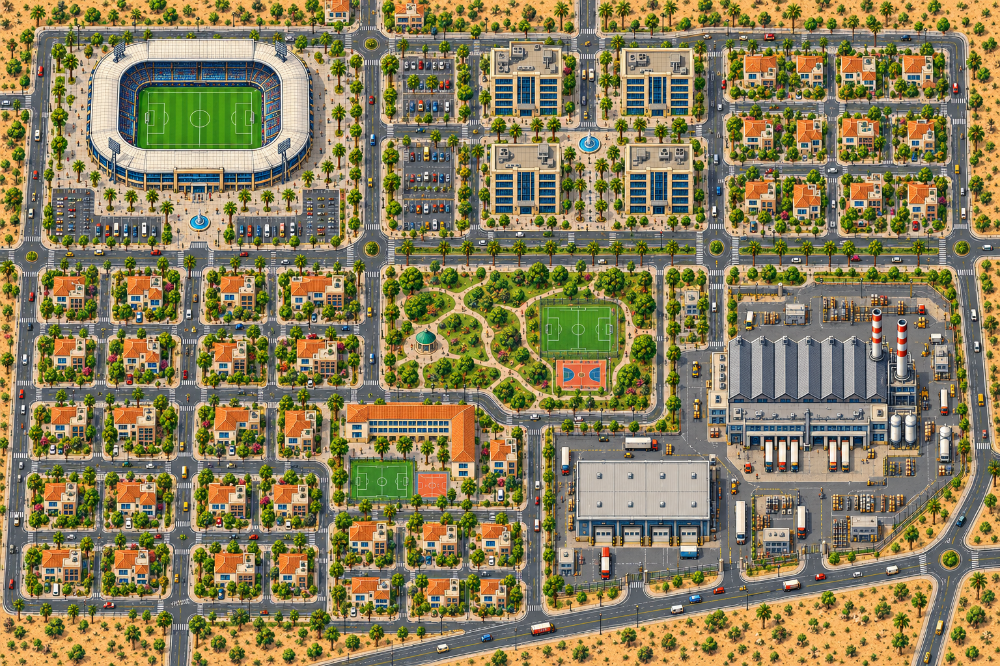

# Structures first, then city

Owner-requested visual experiment. Seven successful built-in ImageGen calls: six individual building drafts, followed by one city conditioned on those six designs and the original city layout. Nothing is approved or replaces the existing engine world.

## Result

[City from the structures](city-from-structures.png), 1536×1024.

## Individual building drafts

[House](structures/house.png), [office](structures/office.png), [school](structures/school.png), [warehouse](structures/warehouse.png), [factory](structures/factory.png), [stadium](structures/stadium.png).

[Actual reference board supplied to ImageGen](reference-board/structures-reference-board.png). The six files exceed the tool's five-reference limit when combined with the layout; the canonical GameArts builder assembled them into one board without changing their source pixels. The city request then used two real reference paths: this board and the original layout. The board's near-key exception is for reference presentation only, not production mask acceptance.

[Prompts and observed tool receipts](image-generation-receipts.json); [hashes, pixel roundtrips and visual findings](review.json).

The building family is more consistent in the composed city: the villas' roof terraces, cream-and-blue offices, school shape, warehouse, factory chimneys and white stadium ring remain recognisable. This is author visual judgement; owner acceptance is pending. ImageGen redraws details and changes counts/geometry; this does not prove exact sprite reuse, scale, C# placement or Godot readiness. The isolated building drafts still need production masking/component/native-grid work if selected for actual game assets.

## Continuation: condition the image on the C# layout

[Engine-layout city trial](city-engine-layout-trial.png), [actual engine diagram supplied](engine-layout-reference.png), [input hashes](engine-layout-inputs.json), [prompt/observed receipt](engine-layout-image-receipt.json), [manual count review](engine-layout-review.json).

One further image call used the actual C# layout diagram, the six-building reference board and the previous city for art treatment. The northern open plots, stadium/park/school/industry positions and diagonal southern bypass follow the engine's broad arrangement more closely. **Count fidelity fails:** visual self-review finds 27 houses instead of 35 and two offices instead of four, yielding 33 buildings instead of 43. Roads, site scale and some architecture are also redrawn. The source world and all references remain unchanged. Exact quantities/geometry require engine placement of stored validated assets; this trial does not establish an exact compiled world.
